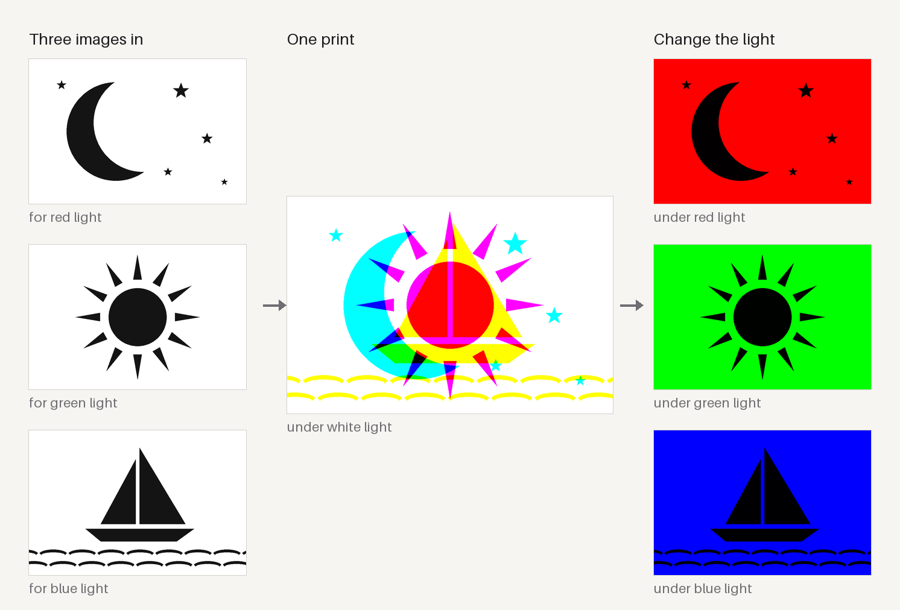
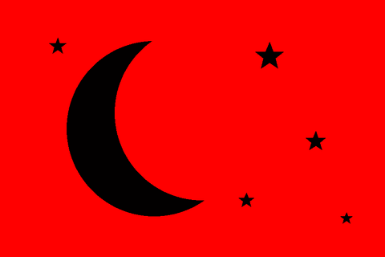
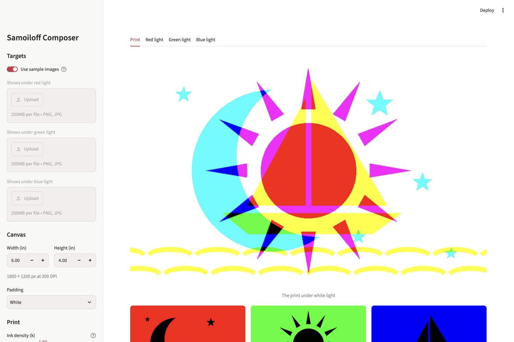

# Samoiloff Effect

**Hide three pictures in one print. Change the color of the light and a different one appears.**

Give it three images. It gives you back a single full-color print where red light shows only the first image, green light only the second, and blue light only the third. It runs as a Streamlit app with live previews, per-image tone controls, 300 DPI output and an animated light-show preview.



<p align="center"></p>

## Quickstart

```bash
git clone https://github.com/joey12725/samoiloff-effect.git
cd samoiloff-effect
python -m venv .venv && source .venv/bin/activate   # Windows: .venv\Scripts\activate
pip install -r requirements.txt
streamlit run app.py
```

The app opens at http://localhost:8501 with the bundled sample images already loaded. Flip **Use sample images** off in the sidebar to upload your own three.

To skip the UI and run the full pipeline from the command line:

```bash
python demo.py --output-dir output
```

That writes the printable image, the three ink plates, the red/green/blue previews and two animated GIFs into `output/`.

## How it works

The name comes from Adrian Samoiloff, a 1920s stage-lighting designer who painted scenery and costumes so that switching the color of the lights changed what the audience saw. This app does the same thing with printer ink and a few lines of color math.

**Subtractive inks each block one primary.** Cyan ink absorbs red light and lets green and blue through. Magenta absorbs green. Yellow absorbs blue. So each ink controls exactly one color channel of the light that comes off the print:

| Ink     | Absorbs | Controlled by                        | Visible under |
|---------|---------|--------------------------------------|---------------|
| Cyan    | red     | image for red light (dark = more ink) | red light     |
| Magenta | green   | image for green light                | green light   |
| Yellow  | blue    | image for blue light                 | blue light    |

**One light, one ink, one image.** Shine pure red light on the print and the magenta and yellow layers have nothing to absorb, so they vanish. Only the cyan layer casts shadows, and the cyan layer *is* the first image. Switch to green and the magenta image takes over. Under white light all three overlap into the colorful mash-up in the middle of the hero image.

**The model.** Each target becomes a grayscale value `g` in linear light (1 = let the light through). Ink coverage is `1 − g`, and a density curve shapes how ink actually builds up on paper:

```
coverage'      = 1 − (1 − coverage)^k        (k = ink density, default 1.5)
transmittance  = 1 − coverage' = g^k          (per channel)
seen(light)    = transmittance × light        (R, G, B multiplied separately)
```

Every step runs in linear light, not sRGB, because that is how light actually adds and multiplies. The same reason makes the animated previews honest: fading from red light to green light is a straight blend in linear space, which is exactly what you would see dimming one lamp while raising the other.

### Pipeline

```
upload ─► fit to canvas (300 DPI, contain + pad)
       ─► sRGB → linear
       ─► levels · contrast/brightness · clarity · sharpen
       ─► color → gray (luminance, max, average or custom mix)
       ─► ink coverage → density curve → print transmittance
       ─► white-light print, CMY plates, R/G/B previews, GIFs
```



## Features

- **Three-target composer** with live previews of the final print and each colored-light reveal
- **Per-image tone controls**: black/white points, gamma, auto-normalize, contrast, brightness, clarity (local contrast), unsharp mask with threshold
- **Four color-to-gray methods**, including a custom channel mix for pulling a subject out of a busy photo
- **Ink density slider** to match your printer and paper
- **Print-ready output** on a fixed 300 DPI canvas of any size, with white or transparent padding
- **One-click export bundle**: `print_white_light.png`, `plate_cyan/magenta/yellow.png`, `under_red/green/blue_light.png`, `rgb_cycle_colored.gif` and `rgb_cycle.gif`
- **Headless pipeline** (`samoiloff.core`) you can import and script without Streamlit

## Making a real one

Print `print_white_light.png` at 100% scale on an inkjet, on paper for reflected light or on transparency film for a backlit panel. Light it with an RGB LED strip or a smart bulb and cycle the colors. Narrow-band LEDs give the cleanest switch between images. Bold, high-contrast targets read best. Silhouettes, line art and big type all work well.

The ink plates are also useful on their own for multi-material work, such as color lithophanes or screen printing, where each ink is its own layer.

## Using the library

```python
from samoiloff import TargetSettings, compose, export_bundle, process_target, RED

canvas = (1800, 1200)  # 6 × 4 in at 300 DPI
grays = [
    process_target(open(p, "rb").read(), canvas, "White", TargetSettings())[0]
    for p in ("moon.png", "sun.png", "boat.png")
]

art = compose(*grays, density=1.5)
art.white_light().save("print.png")
art.lit_by(RED).save("under_red.png")
files = export_bundle(art)  # {filename: bytes}
```

`TargetSettings` bundles the per-image adjustments (`LevelsParams`, `ContrastBrightnessParams`, `ClarityParams`, `SharpenParams`, `GrayMethodParams`). To add a new adjustment, write a function that takes and returns an `H×W×3` linear-light array, add its parameters to `TargetSettings`, and call it from `process_target`.

## Project layout

```
app.py                Streamlit UI
samoiloff/core.py     image pipeline, optics model, GIF and export rendering
demo.py               headless demo; also draws the sample targets and README images
examples/targets/     procedurally generated sample images (moon, sun, boat)
tests/                pytest suite: color math, optics, exports, demo, and a Streamlit AppTest smoke test
```

## Development

```bash
pip install -r requirements.txt pytest ruff
pytest
ruff check . && ruff format --check .
python demo.py --samples --hero docs   # regenerate sample targets and README images
```

CI runs lint and tests on Python 3.11 and 3.13.

## Tech stack

Python, Streamlit, NumPy, Pillow.

## License

MIT. See [LICENSE](LICENSE). The sample images are generated by `demo.py` and are free to reuse.

---

Built by [Joey Hersh](https://github.com/joey12725).
